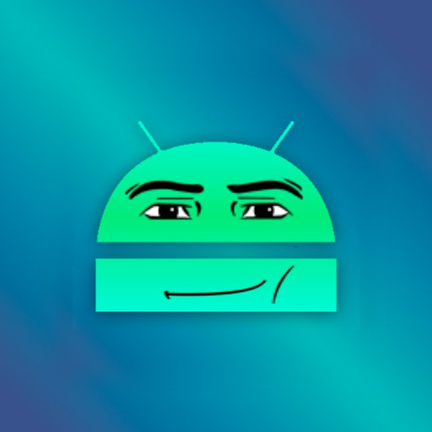
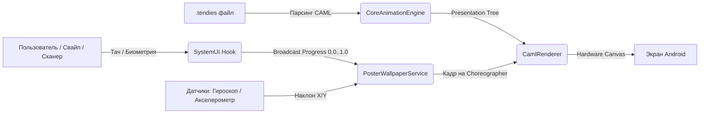

<p align="center">
    <b>PosterDroid</b>
</p>

<p align="center">
  
</p>

<p align="center">
  <b>Нативный движок интерактивных обоев iOS (PosterKit / <code>.tendies</code>) для Android с поддержкой жестов разблокировки и гироскопа.</b>
</p>

<p align="center">
  
  
  
  
  
</p>

---

## ‼️ Важно
- Проект еще является сырым, поддерживается **малое количество обоев**.
- Приложение было создано под системы **AOSP** / **HyperOS** / **OneUI (9)**. Работоспособность на других ОС **не гарантирована** (в то же время поддержка планирует расширяться).
- Требуется **наличие root-прав** и установленный **Xposed-менеджер** (например **LSPosed**).
- Эффект глубины **не поддерживается**, и **не будет поддерживаться**!
- Половина всего тут это **чистый вайбкод**.

## 📖 О проекте

**PosterDroid** — это комплексное решение, переносящее живые анимированные обои Apple iOS (пакеты `.tendies` и разметку Core Animation CAML) на Android. Проект объединяет три ключевых компонента в одно целое:

1. **LSPosed-хук для SystemUI:** перехватывает свайп разблокировки экрана в реальном времени (от `0.0` — заблокирован, до `1.0` — разблокирован) и события биометрии (сканер отпечатка пальца).
2. **Движок живых обоев (`WallpaperService`):** аппаратный рендерер на базе Android Hardware Canvas и Choreographer с регулируемой частотой кадров (30–144 FPS).
3. **Core Animation & CAML Engine:** чистый Kotlin-движок, воссоздающий иерархию слоёв `CALayer`, 3D-матрицы `CATransform3D`, физику пружинных анимаций `CASpringTiming` и систему симуляции частиц `CAEmitterLayer`.

---

## ✨ Возможности

- 🍏 **Поддержка пакетов `.tendies`:** нативный парсер и экстрактор пакетов PosterKit (`main.caml`, ресурсы, шрифты, метаданные).
- 🔓 **Реакция на разблокировку в реальном времени:** плавная анимация слоёв и глубина при свайпе шторки/экрана блокировки.
  - Поддержка **Xiaomi HyperOS / MIUI**
  - Поддержка **Samsung One UI**
  - Поддержка **AOSP / Pixel / Shade**
  - Мгновенная плавная доводка при разблокировке отпечатком пальца.
- 🧭 **3D-параллакс по гироскопу:** отслеживание наклона устройства через `Sensor.TYPE_ROTATION_VECTOR` с автоматической калибровкой нейтрального положения.
- ⚡ **Высокая производительность (до 144 FPS):** слайдер выбора целевой частоты кадров в интерфейсе, синхронизация с Choreographer.

---

## 🏗️ Архитектура

Проект разделён на 3 независимых модуля:

```text
posterdroid/
├── app/               # Основное Android-приложение, UI и хук
│   ├── hook/          # LSPosed хуки для SystemUI (Xiaomi, Samsung, AOSP, Biometrics)
│   ├── wallpaper/     # WallpaperService, Hardware Canvas рендерер и настройки
│   └── ui/            # MainActivity (Material 3 UI, Monet, импорт .tendies, FPS слайдер)
├── caml/              # Независимый Kotlin-движок Apple Core Animation
│   ├── parser/        # Парсер CAML XML, манифестов и .tendies ZIP-архивов
│   ├── model/         # Модели слоёв (CALayer, CAEmitterLayer, CAShapeLayer и т.д.)
│   ├── math/          # CATransform3D (матрицы 4x4), кватернионы, CASpringTiming
│   └── engine/        # Presentation Tree Evaluator и State Controller
└── core/              # Общие константы, IPC-контракты и утилиты
```

### Схема взаимодействия:


---

## 🚀 Установка и запуск

### Требования:
- **Устройство:** Android 8.0 (API 26) или новее (для Monet рекомендуется Android 12+).
- **Для интерактивного свайпа разблокировки:** Root (Magisk / KernelSU / APatch) + **LSPosed**.
  *(Примечание: в качестве обычных живых обоев с анимациями и гироскопом приложение работает и без Root)*.

### Сборка из исходников:
1. Клонируйте репозиторий:
   ```bash
   git clone https://github.com/p4lemoon/PosterDroid.git
   cd PosterDroid
   ```
2. Соберите отладочный APK:
   ```bash
   ./gradlew assembleDebug
   ```
3. Установите APK на подключённое устройство:
   ```bash
   adb install -r app/build/outputs/apk/debug/app-debug.apk
   ```

### Настройка модуля:
1. Откройте **LSPosed Manager**.
2. Активируйте модуль **PosterDroid** и убедитесь, что в области видимости (Scope) выбран **System UI** (`com.android.systemui`).
3. Перезапустите SystemUI (`adb shell pkill -f com.android.systemui` или мягкая перезагрузка устройства).
4. Откройте приложение **PosterDroid**, нажмите **«Применить»** и выберите **PosterDroid** в системном диалоге.
5. Нажмите **«Выбрать»**, чтобы загрузить любой пакет обоев.

---

## 🔧 Отладочные команды (ADB)

В рендерер встроен механизм диагностики для тестирования рендера без необходимости взаимодействия с системным экраном блокировки:

```bash
# Зафиксировать progress на 0.0 (экран блокировки)
adb shell am broadcast -a com.posterdroid.DEBUG_RENDER --ef fixed_progress 0.0

# Зафиксировать progress на 1.0 (рабочий стол)
adb shell am broadcast -a com.posterdroid.DEBUG_RENDER --ef fixed_progress 1.0

# Вернуть динамическое управление от хука (отключить фиксацию)
adb shell am broadcast -a com.posterdroid.DEBUG_RENDER --ef fixed_progress -1.0

# Включить цветную подсветку bounds каждого слоя
adb shell am broadcast -a com.posterdroid.DEBUG_RENDER --ez highlight_bounds true

# Изолировать и показать только конкретный слой по имени
adb shell am broadcast -a com.posterdroid.DEBUG_RENDER --es only_layer_name "black hole"

# Сохранить рендер текущего кадра в PNG заданного размера
adb shell am broadcast -a com.posterdroid.DEBUG_RENDER --es capture_png /data/user/0/com.posterdroid.wallpaper/files/frame.png --ei capture_width 238 --ei capture_height 526
```

---

## 📄 Лицензия

Проект распространяется под лицензией MIT. Подробности см. в файле [LICENSE](LICENSE).

---

хаа тип даже readme через нейронку сделал